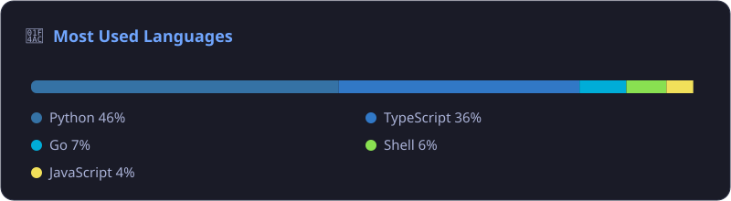

<picture>
  <source media="(prefers-color-scheme: dark)" srcset="./assets/header-dark.svg" />
  
</picture>

<div align="center">
  <h1>Hi, I'm <code>Tom</code> 👋</h1>
  <h3><code>SckyzO</code> • <code>Thomas Bourcey</code></h3>

  

  <p>
    <a href="https://github.com/SckyzO?tab=followers"></a>
  </p>
</div>

### 🧠 About Me


- 🚀 **Role**: Senior Systems & HPC Engineer, based in Toulouse, France.
- 🐧 **Linux addict**: I live in the terminal.
- 📊 **Observability**: Prometheus exporters and Grafana panels for HPC clusters.
- ⚡ **Automation**: Ansible, packaging and CI around it all.
- 🛠️ **Dev**: Python and Go tools that solve real problems.
- 🔭 **Currently building**: [rackscope](https://github.com/SckyzO/rackscope), physical infrastructure visibility for data centers and HPC clusters.
- 📬 **Find me**: 🌐 [tomzone.fr](https://www.tomzone.fr) · 📄 [Resume & contact](https://sckyzo.github.io/SckyzO/)

### 🧪 Languages & Stack


<!-- cards:stack:start -->
<p align="center">
  
  
  
  
  
  
  
  
  
  
</p>
<!-- cards:stack:end -->

<p align="center">
  <b>Setup:</b>
  <kbd> Vim</kbd>
  <kbd> Tmux</kbd>
  <kbd> Zsh</kbd>
  <kbd> Git</kbd>
  <kbd> VS Code</kbd>
</p>

<!-- cards:languages:start -->
<p align="center"></p>

<p align="center">🟦 <b>TypeScript</b> 66 % · 🟩 <b>Go</b> 14 % · 🟨 <b>Python</b> 13 % · 🟪 <b>Go Template</b> 4 % · 🟧 <b>JavaScript</b> 3 %</p>
<!-- cards:languages:end -->

<p align="center"><sub>Share of code in my own public repositories, forks and archived repos excluded.</sub></p>

### 📊 GitHub Stats


<!-- cards:stats:start -->
<div align="center">

| 📦 **61** | ⭐ **108** | 👥 **16** | 🗓️ **15** |
|:-:|:-:|:-:|:-:|
| Repositories | Stars | Followers | Years on GitHub |

</div>
<!-- cards:stats:end -->

<picture>
  <source media="(prefers-color-scheme: dark)" srcset="./assets/snake-dark.svg" />
  
</picture>

### ⭐ Notable projects


<!-- cards:projects:start -->
<table>
<tr><td width="50%" valign="top"><a href="https://github.com/SckyzO/slurm_exporter"><b>slurm_exporter</b></a><br>Slurm Exporter is a Prometheus exporter designed to scrape and expose a comprehensive range of performance and…<br><code>🟩 Go</code> <code>🏷️ v1.8.6</code> <code>⭐ 59</code> <code>🍴 20</code></td><td width="50%" valign="top"><a href="https://github.com/SckyzO/rackscope"><b>rackscope</b></a><br>Physical infrastructure visibility for data centers and HPC clusters<br><code>🟦 TypeScript</code> <code>🏷️ v1.0.0-beta1</code> <code>⭐ 9</code></td></tr>
<tr><td width="50%" valign="top"><a href="https://github.com/SckyzO/cosmos"><b>cosmos</b></a><br>Design system for dashboards and monitoring tools: Tailwind 4 theme with 4 themes and 12 accents, React 19 components…<br><code>🟦 TypeScript</code> <code>🏷️ @sckyzo/cosmos-charts@0.8.1</code> <code>⭐ 3</code></td><td width="50%" valign="top"><a href="https://github.com/SckyzO/monitoring-hub"><b>monitoring-hub</b></a><br>🏭 Automated Software Factory for Prometheus Exporters. Multi-arch RPM/DEB packages + OCI images. GPG-signed…<br><code>🟨 Python</code> <code>🏷️ slurm_exporter-v1.8.3</code> <code>⭐ 2</code></td></tr>
</table>
<!-- cards:projects:end -->

### 🚢 Latest releases


<!-- cards:releases:start -->
```diff
+ grafana-plugin-slurm-panel  v0.1.1                                                  2026-11-05
+ cosmos                      @sckyzo/cosmos-charts@0.8.1                             2026-11-04
+ suivi-loyers                v1.3.1                                                  2026-10-30
+ slurm_exporter              v1.8.6                                                  2026-10-27
+ cosmos-docusaurus-theme     v2.2.7                                                  2026-10-25
```
<!-- cards:releases:end -->

<picture>
  <source media="(prefers-color-scheme: dark)" srcset="./assets/footer-dark.svg" />
  
</picture>
